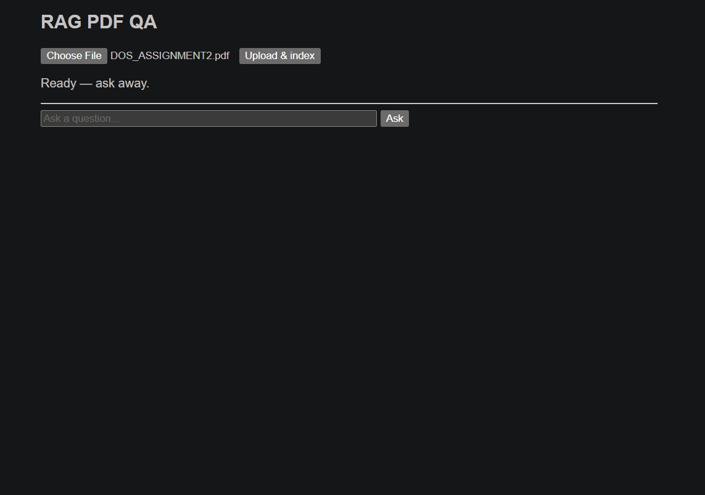
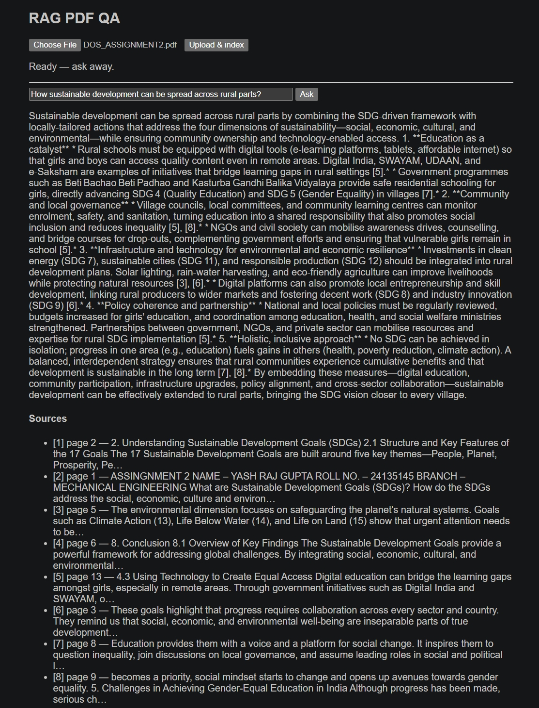

# 📄 AskPDF

<div align="center">

**A hand-rolled Retrieval-Augmented Generation pipeline that answers questions over any PDF — with page citations, zero hallucinations, and no LangChain.**

Upload a PDF. Ask anything. Get answers grounded in your document.

<br />

[](https://www.python.org/)
[](https://fastapi.tiangolo.com/)
[](https://www.trychroma.com/)
[](https://groq.com/)
[](https://pymupdf.readthedocs.io/)

</div>

---

## The Problem: The "Trust Gap" in Document Q&A

LLMs are fluent but untrustworthy with your documents:

*   **Hallucinated answers:** ask about a PDF and the model invents facts with total confidence — there is no link between its words and your file.
*   **No source traceability:** even when the answer is right, you can't check *where* it came from. No page, no passage, no proof.
*   **Manual search doesn't scale:** Ctrl+F across a 50-page PDF for every question is slow, and keyword search misses paraphrases entirely.

**What's needed:** a system where every answer is *retrieved* from the document first and *generated* only from what was retrieved — with citations you can verify and an honest "I don't know" when the document doesn't contain the answer.

---

## Overview

AskPDF implements the full RAG loop by hand — no LangChain, no black boxes. A PDF goes in; grounded, cited answers come out.

```text
PDF document
        ↓
Text extraction (page numbers preserved)
        ↓
Overlapping chunks, tagged with page + chunk_id
        ↓
Embeddings (384-dim vectors)
        ↓
ChromaDB vector store (HNSW index)
        ↓
Question → semantic retrieval (top-k chunks)
        ↓
Groq LLM answers ONLY from retrieved context
        ↓
Answer with page citations — or "I don't know"
```

---

## 🎯 Project Goals

### 1. No frameworks, no magic
Every stage is explicit code (`pipeline/ingest.py`, `chunk.py`, `embed.py`, `store.py`, `retrieve.py`, `generate.py`). If you can't whiteboard a layer, you don't get to keep it.

### 2. Citations or it didn't happen
Every chunk carries its page number from extraction to answer. Responses cite pages like [1], [2] — traceable back to the source PDF.

### 3. Anti-hallucination by construction
The generation prompt is strict: answer **only** from the retrieved context, output exactly `I don't know` otherwise. Verified with out-of-context probes.

### 4. Async ingestion API
Uploads process in the background — the API never blocks on embedding a 50-page PDF. Clients poll a `processing` / `ready` / `error` status.

### 5. Measured, not vibes-based
Retrieval is scored on a fixed question set: **6/7 queries return the correct chunk at rank 1–2**. Chunk size, overlap, and k are judged against this number.

---

## 🧠 Architecture


```text
                 ┌──────────────┐
                 │   PDF file   │
                 └──────┬───────┘
                        │ PyMuPDF — text per page, page numbers kept
                        ▼
                 ┌──────────────┐
                 │    Chunk     │  ~500 words, 60-word overlap
                 │              │  scraps <30 words dropped
                 └──────┬───────┘
                        │ all-MiniLM-L6-v2, L2-normalized
                        ▼
                 ┌──────────────┐
                 │    Embed     │  384-dim float32 vectors
                 └──────┬───────┘
                        │
                        ▼
                 ┌──────────────┐
                 │   ChromaDB   │  PersistentClient, one collection
                 │              │  per document (doc_{id})
                 └──────┬───────┘
                        │
        ┌───────────────┴───────────────┐
        │ "What were the five themes?"  │
        └───────────────┬───────────────┘
                        │ HNSW search, top-k=8
                        ▼
                 ┌──────────────┐
                 │  Groq LLM    │  openai/gpt-oss-20b, temperature=0
                 │              │  system prompt enforces grounding
                 └──────┬───────┘
                        ▼
                 ┌──────────────┐
                 │   Answer +   │
                 │   citations  │
                 └──────────────┘
```

**Ingestion details:**
- **Extract** — PyMuPDF, one rule: never lose the page number. Scanned/image PDFs fail loudly (OCR out of scope).
- **Chunk** — overlapping windows keep context across boundaries; each chunk tagged `{page, chunk_id}` for traceability.
- **Embed** — model loaded once; L2 normalization makes cosine similarity a plain dot product.
- **Store** — ChromaDB reports **squared** L2 distance, so `reported = 2 − 2·cos θ`.

**Query details:**
- The question is embedded with the same model; retrieval returns `{text, page, score}` per chunk.
- The prompt packs the chunks + strict grounding rules; the model cites or abstains.

---

## ✨ Core Features

### Grounded Q&A with citations

```text
Q: Who is the owner of this assignment?
```

Becomes:

```text
The owner of the assignment is YASH RAJ GUPTA [1].

Sources:
[1] p.1 — "...YASH RAJ GUPTA..."
```

### Honest abstention

```text
Q: What is the capital of France?

A: I don't know.
```

The document doesn't contain the answer, so the system says so — instead of inventing one.

### Async document ingestion

Uploads return immediately; embedding runs in the background. Poll `GET /documents/{id}/status` until `ready`, then ask.

---

## 📊 Retrieval Quality

Evaluated on a multi-page assignment PDF, 7 questions:

| # | Question topic | Correct chunk rank |
|---|---|---|
| 1 | Five themes | 2 |
| 2 | Environmental factors | 1 |
| 3 | Government programs | 5 |
| 4 | Root causes | 1 |
| 5 | Beyond goals 4 & 5 | 1 |
| 6 | Strategies | 1–4 |
| 7 | 2015 / MDGs | 1 |

**6/7 at rank 1–2.** Q3 is the honest weak spot: broad topics retrieve well, narrow aspects can sink — the roadmap is an eval harness to track this properly.

---

## 🔮 Future Plans

- [ ] **Eval harness** — automated scoreboard over a fixed question set (recall@k), so chunking and retrieval tweaks are judged by numbers, not vibes
- [ ] **Resume analyzer mode** — rubric-driven resume scoring endpoint (`POST /analyze`), dogfooded on real resumes
- [ ] **Reranker** — cross-encoder rerank on top of HNSW retrieval for harder queries
- [ ] **React UI** — replace the static page with a proper frontend (upload progress, chat-style Q&A)
- [ ] **Deployment** — public demo instance (HuggingFace Spaces)

---

## 🔌 API

| Method | Endpoint | Description |
|---|---|---|
| POST | `/documents` | Upload a PDF → background ingestion starts |
| GET | `/documents/{id}/status` | `processing` / `ready` / `error` |
| POST | `/ask` | `{doc_id, question}` → grounded answer + citations |

A single-page UI is served at `/`.

---

## 📁 Project Structure

```text
AskPDF/
├── app/
│   ├── main.py            # FastAPI app: endpoints + background ingestion
│   └── static/
│       └── index.html     # single-page UI
├── pipeline/
│   ├── ingest.py          # PDF text extraction (PyMuPDF)
│   ├── chunk.py           # overlapping chunking, page + chunk_id tags
│   ├── embed.py           # all-MiniLM-L6-v2 embeddings (384-dim)
│   ├── store.py           # ChromaDB vector store
│   ├── retrieve.py        # HNSW semantic search
│   └── generate.py        # Groq LLM grounded generation
├── test_*.py              # per-stage sanity tests
├── requirements.txt
├── .env                   # GROQ_API_KEY (never committed)
└── README.md
```

---

## 🖼️ Screenshots

### 1. Upload a PDF


### 2. Ready to ask



### 3. Grounded answer with citations



---

## 🛠️ Run it

```bash
pip install -r requirements.txt
# add your key to .env → GROQ_API_KEY=...
uvicorn app.main:app --reload
```

Open `http://localhost:8000`, upload a PDF, and ask away.

---

## 👤 Author

**Yash Raj Gupta**
B.Tech Mechanical Engineering (2024–2028), IIT (BHU) Varanasi

- GitHub: [@YashRajGupta-1](https://github.com/YashRajGupta-1)
